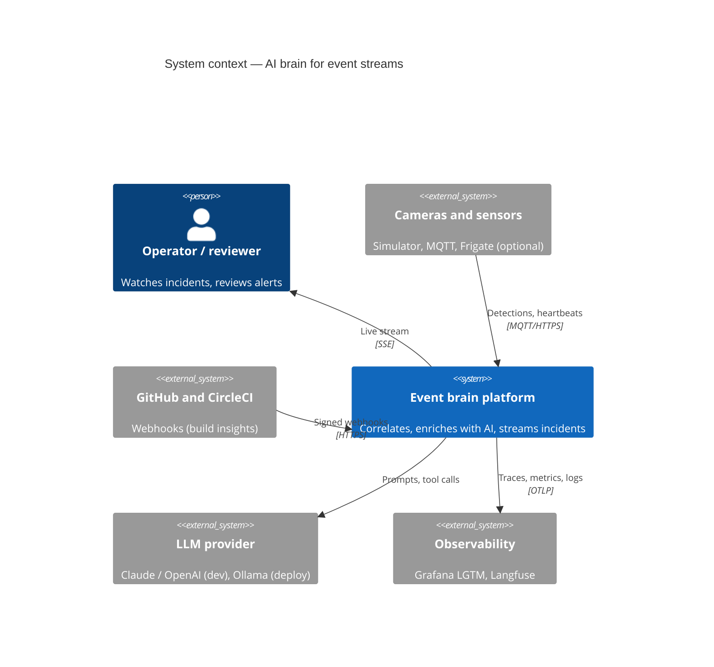
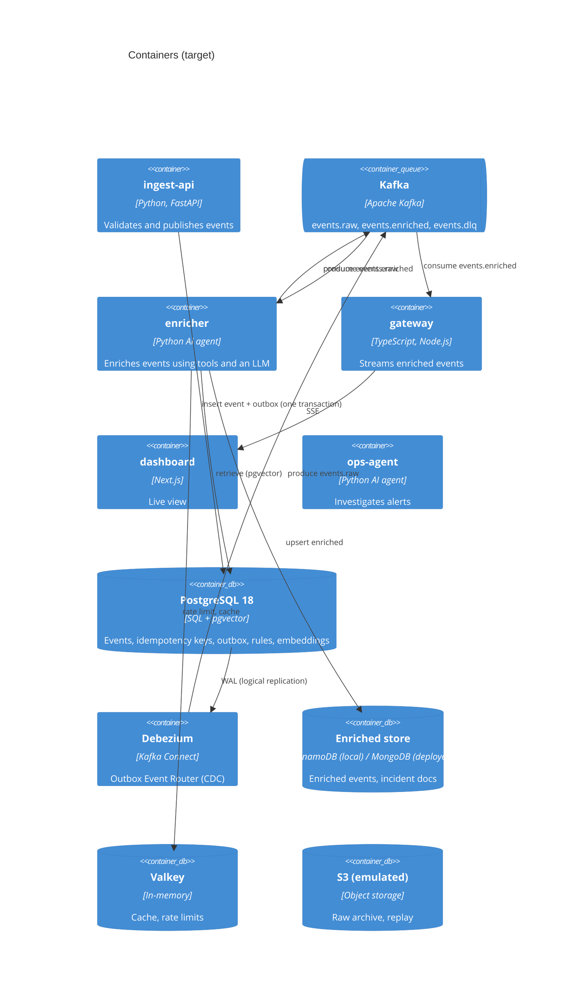

# Architecture (arc42)

This is a living document, updated in the same PR as the code (see the `architecture-docs` skill). Sections marked *TBD* are filled in as the platform grows.

## 1. Introduction and goals
An AI brain for event streams (see [PRODUCT.md](../PRODUCT.md)). The primary product is a **smart surveillance brain**: it turns camera detections into a few explained incidents, privacy by design. The second domain is **build insights** from GitHub and CircleCI events.

Top quality goals:
1. **Reliability:** no lost or duplicated events (idempotency, DLQ, at-least-once with idempotent consumers)
2. **Observability:** every event traceable end to end, across HTTP, Kafka, the agent and SSE
3. **Changeability:** ports and adapters; providers swappable by configuration

## 2. Constraints
- Every tool must be free for the learner to use. Open source is preferred if it's the industry standard.
- AWS runs locally only (AWS Emulator, Floci). Real deployment uses free tiers outside AWS.
- Subscription LLM credentials are for local development only.
- Each increment is 10–20 minutes of work.

## 3. Context and scope

## 4. Solution strategy
Event-driven (Kafka), a transactional outbox with CDC, polyglot persistence with a purpose (ADR-0006), async-first services, ports and adapters, spec-driven development (OpenSpec) with TDD, contracts first (OpenAPI and AsyncAPI), observability by default.

## 5. Building block view

## 6. Runtime view
*TBD:* sequence diagrams for ingest, enrichment and streaming.

## 7. Deployment view
*TBD:* local Docker Compose → kind → free-tier hosts (Vercel, Aiven, Render/Koyeb, Oracle Cloud).

## 8. Cross-cutting concepts
*TBD:* observability, error handling and retries, security, testing strategy.

## 9. Architecture decisions
See [docs/adr/](../adr/).

## 10. Quality requirements
Quality scenarios are measurable NFRs, tested automatically (skill `performance-and-nfr-testing`). The table grows as challenges add them.

| ID | Quality | Scenario | Target | Test |
|---|---|---|---|---|
| QS-1 | Latency | Valid events POSTed at the expected rate | p95 < 150 ms, p99 < 400 ms, errors < 0.1% | k6 load (`tests/perf/`) *TBD* |
| QS-2 | Freshness | An event is enriched and visible on the dashboard | 99% in < 5 s end to end | k6 + trace timing *TBD* |
| QS-3 | Resilience | The LLM provider times out for 60 s | No lost events; DLQ or retry; recovery < 2 min | Toxiproxy fault test *TBD* |
| QS-4 | Stability | Expected load for 60 min | No memory, connection or lag drift | k6 soak *TBD* |
| QS-5 | Web performance | Dashboard first load | LCP < 2.5 s, INP < 200 ms, CLS < 0.1 | Lighthouse CI *TBD* |
| QS-6 | Accessibility | Dashboard pages | WCAG 2.2 AA, no axe violations | axe-core + Playwright *TBD* |

The targets are starting points, refined from SLOs as the platform grows.

## 11. Risks and technical debt
- Free tiers change without notice; their limits are checked again before deployment work.
- Free web services sleep when idle, which affects Kafka consumers (an ADR is due in Phase 7).

## 12. Glossary
| Term | Meaning |
|---|---|
| Enrichment | Adding AI-derived fields (classification, summary, entities) to an event |
| DLQ | Dead-letter queue/topic for events that failed processing |
| Spec delta | An OpenSpec change describing added, modified or removed requirements |
| Detection | A single camera observation (for example "person, 0.91, back door"); never identifies who |
| Incident | A correlated, deduplicated group of detections with a severity and an explanation |
| Heartbeat | A periodic "camera alive" event; a gap means the camera is offline |
| Event time / processing time | When something happened at the camera vs when the platform saw it; they differ because of clock skew and delays |
| Tenant / domain | A product plugged into the shared engine (surveillance, build insights), isolated by row-level security |
