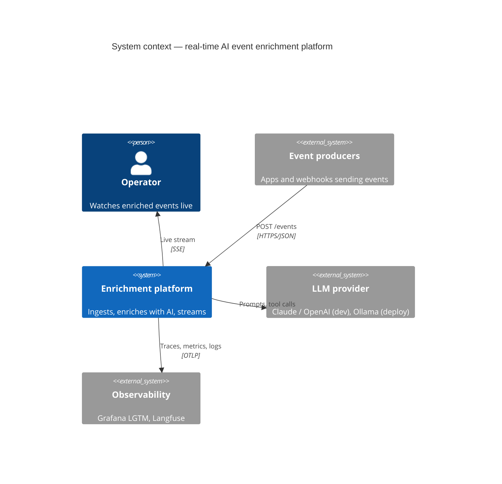
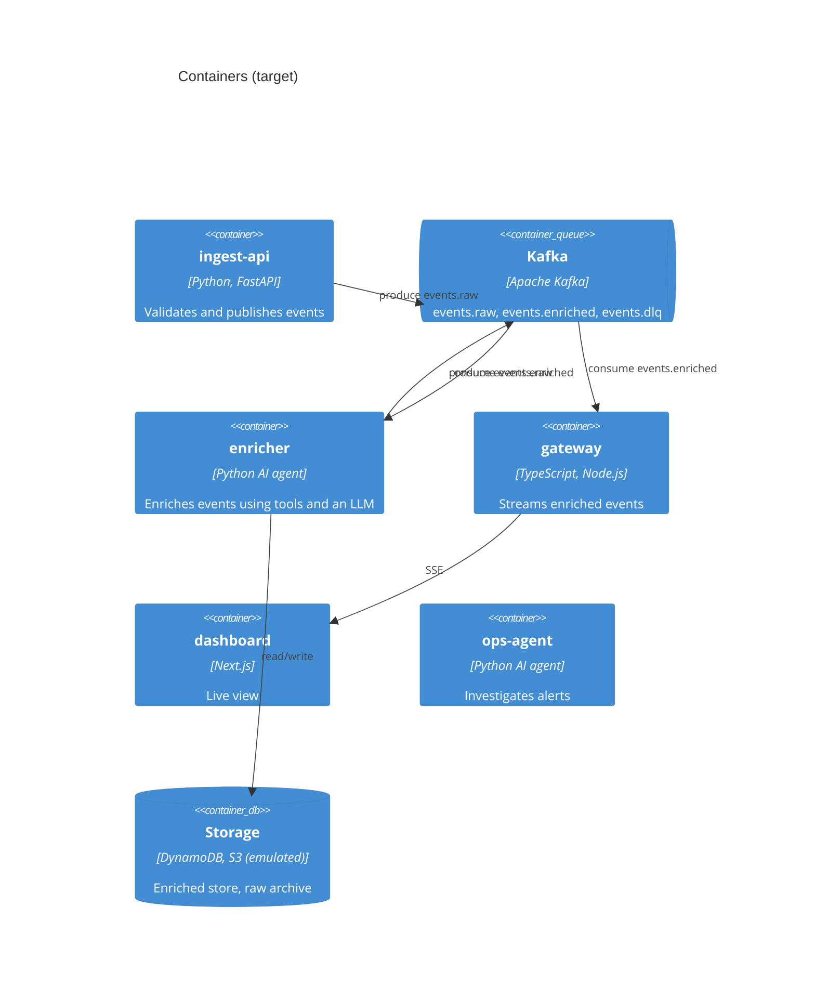

# Architecture (arc42)

This is a living document, updated in the same PR as the code (see the `architecture-docs` skill). Sections marked *TBD* are filled in as the platform grows.

## 1. Introduction and goals
Ingest events, enrich them in real time with AI agents, and stream the results to a live dashboard.

Top quality goals:
1. **Reliability:** no lost or duplicated events (idempotency, DLQ, at-least-once with idempotent consumers)
2. **Observability:** every event traceable end to end, across HTTP, Kafka, the agent and SSE
3. **Changeability:** ports and adapters; providers swappable by configuration

## 2. Constraints
- Every tool must be free for the learner to use. Open source is preferred if it's the industry standard.
- AWS runs locally only (AWS Emulator, Floci). Real deployment uses free tiers outside AWS.
- Subscription LLM credentials are for local development only.
- Each increment is 10–20 minutes of work.

## 3. Context and scope

## 4. Solution strategy
Event-driven (Kafka), async-first services, ports and adapters, spec-driven development (OpenSpec) with TDD, contracts first (OpenAPI and AsyncAPI), observability by default.

## 5. Building block view

## 6. Runtime view
*TBD:* sequence diagrams for ingest, enrichment and streaming.

## 7. Deployment view
*TBD:* local Docker Compose → kind → free-tier hosts (Vercel, Aiven, Render/Koyeb, Oracle Cloud).

## 8. Cross-cutting concepts
*TBD:* observability, error handling and retries, security, testing strategy.

## 9. Architecture decisions
See [docs/adr/](../adr/).

## 10. Quality requirements
*TBD:* quality scenarios, for example "99% of events are enriched in under 5 s".

## 11. Risks and technical debt
- Free tiers change without notice; their limits are checked again before deployment work.
- Free web services sleep when idle, which affects Kafka consumers (an ADR is due in Phase 7).

## 12. Glossary
| Term | Meaning |
|---|---|
| Enrichment | Adding AI-derived fields (classification, summary, entities) to an event |
| DLQ | Dead-letter queue/topic for events that failed processing |
| Spec delta | An OpenSpec change describing added, modified or removed requirements |
